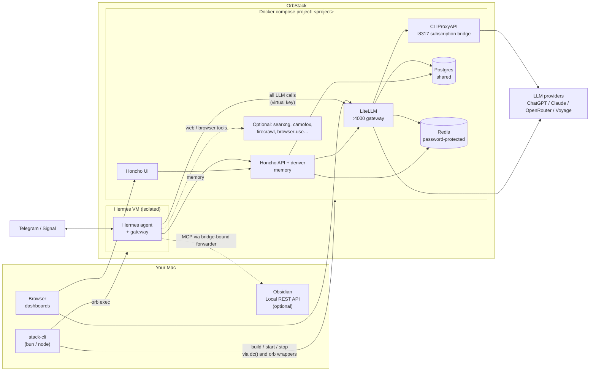
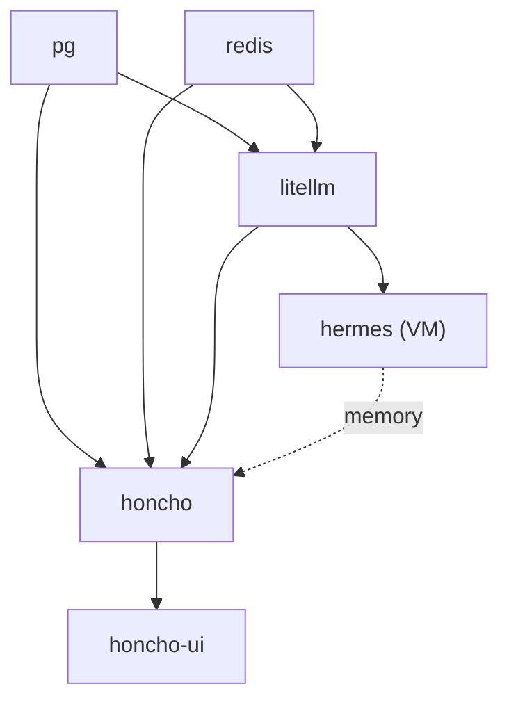

# Running the stack

How to bring the stack up, what healthy looks like, and how the pieces fit.
For the deep dive on scoping, secrets and the build pipeline see
[architecture.md](architecture.md); for pitfalls see [gotchas.md](gotchas.md).

## Where to run commands

Always from the **repo root** (the directory containing `stack-cli`):

```bash
cd ~/hermes-stack
./stack-cli <command>
```

Run them in your **own terminal app** (Terminal, iTerm, Ghostty…), not from
inside a sandboxed tool. Bun/Node must be able to reach `*.orb.local` — see
[Troubleshooting](#troubleshooting).

## Start the stack

```bash
# One time (or after pulling changes that touch services/)
./stack-cli setup        # interactive: project name, services, models
./stack-cli build        # resolve image digests, fetch sources, render configs, mint secrets

# Every time
./stack-cli start        # bring it all up
./stack-cli info         # confirm it is healthy
./stack-cli stop         # pause; volumes (data) are kept
```

Prerequisite: **OrbStack must be running** before `start`.

Re-run `build` whenever you change a service's template, `service.yaml`, or
pull code that does. `start` alone does not re-render configs.

### What `start` does, in order

1. **backends** — `pg`, `redis` come up first.
2. **preflight** — `litellm` is brought up and waited on
   (`/health/liveliness`, up to ~4 min), then one virtual key is minted per
   consumer into `.stack/litellm/.generated.env`.
3. **prestart** — fail-loud validation per service.
4. **`dc up -d`** — everything else; one-shot provisioners (DB roles, schemas)
   run via compose `depends_on`.
5. **poststart** — hooks that need serving dependencies.
6. **VM start** — the Hermes VM's `start.ts` re-applies config and starts the
   gateway.

If a step fails, the CLI exits with a `FATAL:` line naming the step. Fix the
cause and re-run `start`; every step is idempotent.

## What to look for

### `./stack-cli info`

- Every enabled container `running`/`healthy`; provisioner containers
  (`*-provision`, `*-schema`) show **Exited (0)** — that is correct.
- The Hermes VM is `running`.
- URLs under each service (`<service>.<project>.orb.local`). Credentials are
  shown as `$VAR` names; `./stack-cli info --show-pass` resolves them.

### Quick health checks

```bash
# LiteLLM gateway (default project name `aitools`)
curl -s http://litellm.aitools.orb.local:4000/health/liveliness     # "I'm alive!"

# Containers
docker ps --format '{{.Names}}\t{{.Status}}'

# Hermes VM console
./stack-cli logs
```

### Signals that something is wrong

| Symptom | Likely cause |
|---|---|
| `FATAL: litellm not serving /health/liveliness` | litellm still starting or crashed — `docker logs <project>-litellm-1`; or your terminal can't reach `*.orb.local` (see below) |
| A container restarting in a loop | `docker logs` it; usually a bad rendered config — re-run `build` |
| `NOAUTH` / `WRONGPASS` in logs | a consumer has the wrong Redis password — re-run `build` then `restart` |
| 401 from LiteLLM | stale virtual key — see gotcha #4 (fresh pg invalidates keys) |
| Hermes answers but ignores memory | Honcho unhealthy — `info`, then `docker logs <project>-honcho-api-1` |

## Architecture



Key properties:

- **Hermes is isolated.** It runs in an OrbStack VM with no access to your Mac
  filesystem unless you grant it; its only door to LLMs is LiteLLM.
- **LiteLLM is the single gateway.** Every consumer gets its own virtual key,
  so budgets, rotation and logs are per consumer.
- **Services find each other by name.** No published host ports; the Mac and
  the VM use OrbStack DNS `<service>.<project>.orb.local`.
- **State lives in `.stack/`** (gitignored): `.env` is the only config;
  each service owns its secrets in `.stack/<svc>/.generated.env`.

### Startup dependency order



`./stack-cli enable <svc>` pulls in `requires` transitively; `disable` refuses
while a dependant is enabled.

## Troubleshooting

**`EHOSTUNREACH` / "Unable to connect" to `*.orb.local` from Bun or Node, but
`curl` works.** macOS Local Network privacy is blocking the process. Run
`stack-cli` from a normal terminal app and enable that app under
*System Settings → Privacy & Security → Local Network*. Tools running in a
restricted environment may not be able to reach OrbStack at all.

**`start` fails right after changing compose files.** Containers whose
config changed are recreated; a slow recreate can outlast preflight's wait.
Re-run `./stack-cli start` once.

**Backing up before risky changes:** copy `.stack/` to the repo-root `_bak/`
(never `/tmp` — it holds secrets). `_bak/` is gitignored.

**Two Obsidian vaults open at once** (if you use the Obsidian MCP): both
plugins claim ports 27123/27124 and only one wins. Keep one vault open.
